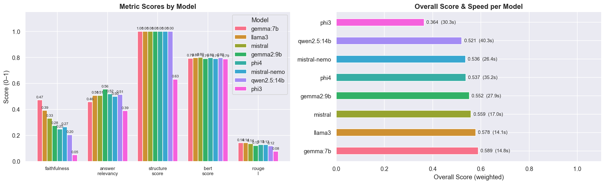
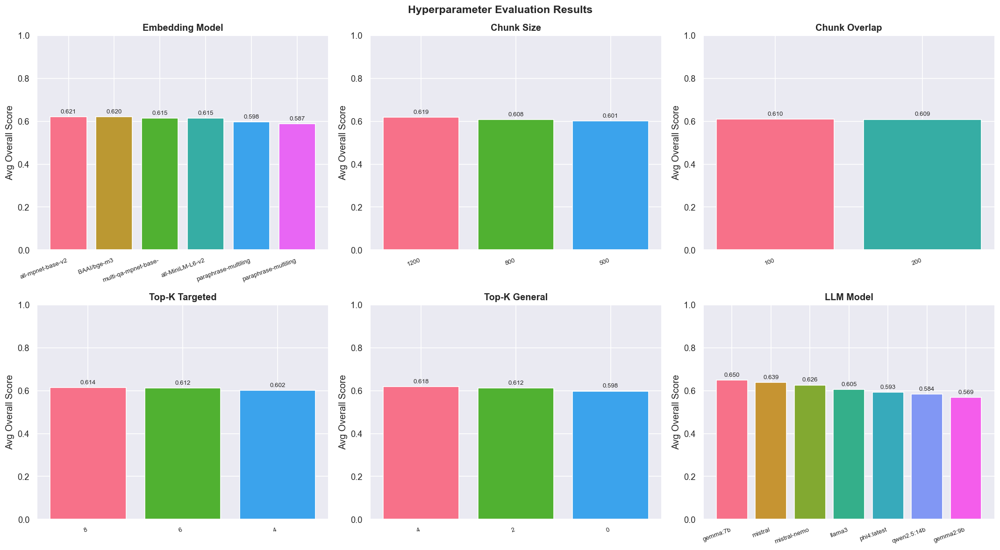

# CR Impact Analyzer

A local, fully offline **RAG (Retrieval-Augmented Generation) pipeline** that reads a system's technical documentation (PDFs) and automatically generates a structured **impact analysis** for a given Change Request (CR) — affected components, dependencies, risks, and test scope — grounded only in the retrieved docs.

Built with **LangChain**, **ChromaDB**, **Sentence-Transformers**, and **Ollama** (local LLMs — no API keys, no data leaving your machine). Includes a full evaluation harness that scores and compares LLMs on faithfulness, relevancy, and structure, and a hyperparameter search over the entire RAG configuration space (embedding model, chunk size/overlap, top-k, LLM).

> **Note on the example data:** the CR examples and documentation excerpts used throughout the notebooks are synthetic (a fictional "Northwind OMS" order-management system), created to demonstrate the pipeline without exposing real business data. Swap in your own PDFs and CRs to use it for real.

## How it works

```
PDFs  ──►  chunk  ──►  embed  ──►  ChromaDB (persistent vector store)
                                          │
CR description  ──►  embed  ──►  similarity search (top-k)
                                          │
                              retrieved excerpts + CR  ──►  local LLM (Ollama)
                                          │
                              structured impact analysis (Markdown)
```

Retrieval is **hybrid**: it first pulls chunks specifically tagged with the CR number being discussed (if the CR itself was indexed), then blends in general top-k chunks from the rest of the knowledge base — so the model gets both the specific CR text and the surrounding system documentation it affects.

## Notebooks

| # | Notebook | Purpose |
|---|----------|---------|
| 1 | [`01_setup_and_config.ipynb`](notebooks/01_setup_and_config.ipynb) | One-time environment check — imports, Ollama connectivity, folder setup |
| 2 | [`02_build_vectordb.ipynb`](notebooks/02_build_vectordb.ipynb) | Extracts PDFs → chunks → embeddings → persists to ChromaDB |
| 3 | [`03_analyze_cr.ipynb`](notebooks/03_analyze_cr.ipynb) | Main workflow — paste a CR, get a structured impact analysis |
| 4 | [`04_evaluate_models.ipynb`](notebooks/04_evaluate_models.ipynb) | Compares LLMs (faithfulness, answer relevancy, ROUGE-L, BERTScore, structure, speed) |
| 5 | [`05_hyperparameter_evaluation.ipynb`](notebooks/05_hyperparameter_evaluation.ipynb) | Grid search over embedding model, chunk size/overlap, top-k, and LLM |

[`archive/`](archive/) holds earlier iterations of notebooks 2 and 3, kept to show how retrieval evolved (bigger chunks to preserve full procedure steps, CR-targeted + general hybrid retrieval, reranking).

## Results

**Model comparison** — weighted score across faithfulness, answer relevancy, structure adherence, BERTScore, and ROUGE-L, plus generation speed:



`gemma:7b` came out on top on the weighted score, edging out `llama3` and `mistral` while running at a comparable speed — despite being a smaller model than `qwen2.5:14b` or `phi4`.

**Hyperparameter search** — average score across the full RAG configuration grid:



Key findings: `all-mpnet-base-v2` and `BAAI/bge-m3` outperformed smaller/multilingual embedding models for this technical-document use case; larger chunks (1200 chars) beat smaller ones, likely because they keep full procedure steps intact instead of splitting mid-step; and the LLM choice had a bigger effect on overall score than any single RAG parameter.

## Setup

**Prerequisites**
- Python 3.10+
- [Ollama](https://ollama.com) installed and running locally (`ollama serve`), with at least one model pulled, e.g. `ollama pull gemma:7b`

**Install**
```bash
git clone https://github.com/bssam99/cr-impact-analyzer.git
cd cr-impact-analyzer
pip install -r requirements.txt
```

**Run**
1. Open `notebooks/01_setup_and_config.ipynb` and run it once to verify your environment.
2. Drop your PDFs into the `pdfs/` folder it creates.
3. Run `notebooks/02_build_vectordb.ipynb` once to build the vector store.
4. Run `notebooks/03_analyze_cr.ipynb` any time you have a new CR to analyze.
5. (Optional) Run notebooks 4–5 to evaluate models/hyperparameters on your own document set.

## Tech stack

`Python` · `LangChain` · `ChromaDB` · `Sentence-Transformers` · `Ollama` · `PyMuPDF` · `pandas` · `matplotlib`/`seaborn` · `rouge-score` · `bert-score`

## License

[MIT](LICENSE)
